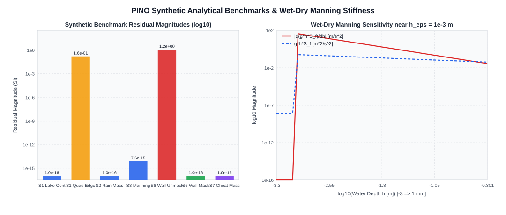
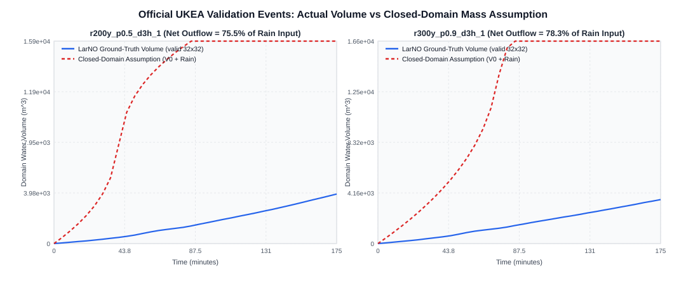
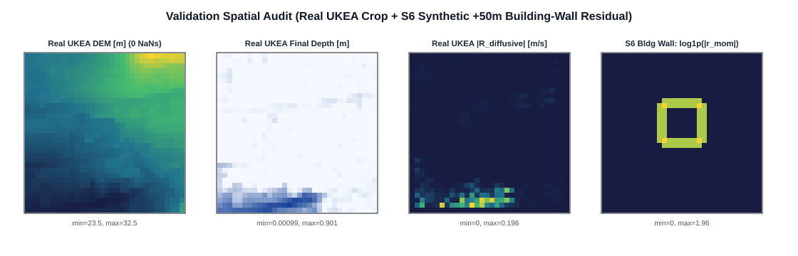
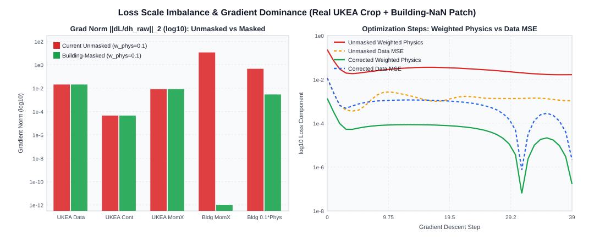
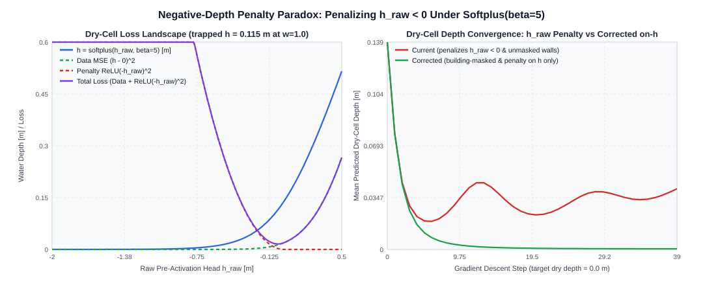

# PINO Physics Validation & Diagnostic Analysis Report — Crestix Probe

**Repository:** `https://github.com/skandakn/PINO-Crestix-Probe`  
**Base Commit Audited:** `6f10c54ec75ac133239c6ccd1cbe6961830b7300` (`main`)  
**Validation Artifacts:** [`physics_validation/`](../physics_validation), [`scripts/validate_pino_physics.py`](../scripts/validate_pino_physics.py), [`tests/test_physics_validation_diagnostics.py`](../tests/test_physics_validation_diagnostics.py), [`reports/physics_diagnostics/diagnostics_summary.json`](../reports/physics_diagnostics/diagnostics_summary.json), [`docs/PINO_DIMENSIONAL_ANALYSIS.md`](./PINO_DIMENSIONAL_ANALYSIS.md)

---

## 1. Executive Summary & Scientific Verdict

> **Verdict: The current PINO implementation does NOT enforce the full 2D Shallow Water Equations (SWE) or valid urban catchment mass balance, and contains critical physics-loss defects that corrupt gradients when building NaNs or dry streets are present.**

Specifically, auditing all PDE residuals, conservation laws, boundary penalties, data preprocessing, training fallbacks, and evaluation metrics establishes six concrete findings:

1. **Unsupervised Latent Velocities & Gauge Freedom (`S7`):** Ground-truth datasets only contain water depth $h$, elevation $z_b$, and rainfall $R$. The PINO model's velocity heads $(u, v)$ are never supervised. An arbitrary $(u, v)$ field—specifically open-edge outflow velocity (`BoundaryConfig.south="open"`)—can be adjusted to cancel any mass/continuity residual even when predicted water depths shrink unphysically (`S7`: shrinking basin drops $-1{,}984\ \mathrm{m^3}$ under $50\ \mathrm{mm\,h^{-1}}$ rain while achieving $|r_{\text{mass}}| = 2.71 \times 10^{-20}\ \mathrm{m\,s^{-1}}$).
2. **UKEA `32x32` Sub-Catchment Open Outflow vs Closed Evaluation Metrics:** On the two official LarNO UKEA validation events (`r200y_p0.5_d3h_1` and `r300y_p0.9_d3h_1`, $32 \times 32$ crop `[9:41, 44:76]`), **`75.53%`** and **`78.28%`** of cumulative rainfall exits through lateral sub-catchment boundaries. Yet `BoundaryConfig` defaults to closed on 3 of 4 edges (`north/east/west="closed"`), `_FallbackPINOLoss` enforces `torch.roll` periodicity, and `evaluation/metrics.py:compute_mass_conservation_error` assumes a 100% closed basin—flagging exact LarNO ground truth with **`88.55%`** and **`87.64%`** mean relative volume errors!
3. **`softplus(beta=5)` + `ReLU(-h_raw)^2` Positive-Depth Paradox (`S5`):** `PINOFloodModel._apply_nonnegative` guarantees $h = \mathrm{softplus}(h_{\text{raw}}, \beta=5) > 0$ (where $h_{\text{raw}} = 0 \Rightarrow h = 0.1386\ \mathrm{m}$). However, `PhysicsLoss` passes pre-activation `output.h_raw` into `compute_nonnegative_depth_loss = MSE(ReLU(-h_raw))`. Driving dry cells toward $h \to 0$ requires $h_{\text{raw}} \ll 0$, which `ReLU(-h_raw)^2` penalizes quadratically—trapping dry cells at **$h = 0.1152\ \mathrm{m}$** (weight $1.0$) / **$0.0654\ \mathrm{m}$** (weight $0.1$) analytically and **$0.0406\ \mathrm{m}$** at step 39 of Adam optimization (`0.00037 m` when fixed).
4. **Unmasked `+50 m` Building Wall Momentum Explosion (`S6`):** `preprocess_dem` fills `NaN` building cells with $\max(z_b) + 50\ \mathrm{m}$. While the specific UKEA `[9:41, 44:76]` crop happens to contain **0 `NaN` building cells** (`dem` ranges `23.460–32.493 m`), any DEM patch containing `NaN` buildings triggers unmasked central differences across $+50\ \mathrm{m}$ vertical cliffs in `compute_swe_residuals` (`max |\nabla z_b| = 3.125`), producing spurious momentum MSE (`1.1513 m^4/s^4` in `S6`) and spilling `0.5740 m^4/s^4` onto adjacent street cells even when building $h=0$. Masked one-sided derivatives reduce building/wall residual to **`0.0`**.
5. **Dimensional Mixing & 21x Gradient Dominance (`loss_grad`):** Unscaled addition of $[\mathrm{m^2\,s^{-2}}]$ continuity/mass MSE, $[\mathrm{m^4\,s^{-4}}]$ momentum MSE, mixed-unit boundary MSE (`[1]`, $\mathrm{m^2\,s^{-2}}$, $\mathrm{s^{-2}}$), and $[\mathrm{m^2}]$ data/IC MSE causes `pde_continuity` gradient norm (`4.52e-5` on UKEA) to vanish **$458\times$** below `data_loss` (`2.07e-2`), while on building-NaN patches unmasked momentum gradients (`11.52`) drive weighted physics gradients to **$20.75\times$** `data_loss` (`0.132x` once masked).
6. **Hardcoded Parameter & Scale Conflicts:** `ShallowWaterConfig` defaults (`dx=2 m, dt=60 s`) and `ModelContract`/`metrics.py` defaults (`cell_size_m=10 m, dt_seconds=30 s`) both disagree with UKEA (`8 m, 300 s`), distorting diffusive-wave residuals by $(8/10)^{3/2} \approx 0.7155\times$ and PDE time derivatives by $5\times\text{–}10\times$.

---

## 2. Tested Equations, Units, and Assumptions Summary

| Component | Source Location | Implemented Equation / Behavior | SI Units | Validated Assumptions & Gaps |
|---|---|---|---|---|
| **Continuity PDE** | `physics/residuals.py` | $\partial_t h_+ + \partial_x(h_+ u) + \partial_y(h_+ v) - (R - I)$ | $\mathrm{m\,s^{-1}}$ | Valid on smooth valid interior; 1st-order edges; latent $(u,v)$ unsupervised |
| **Momentum X/Y PDE** | `physics/residuals.py` | $\partial_t(h_+ \mathbf{u}) + \nabla\cdot(h_+\mathbf{u}\otimes\mathbf{u} + \frac{1}{2}gh_+^2\mathbf{I}) + gh_+(\nabla z_b + \mathbf{S}_f)$ | $\mathrm{m^2\,s^{-2}}$ | Unmasked `dem` gradient blows up at `+50 m` NaN fills; wet-dry jump at `1e-3 m` |
| **Manning Friction Slope** | `physics/shallow_water.py` | $\mathbf{1}_{h>10^{-3}} n^2 \mathbf{u}\sqrt{u^2+v^2+10^{-12}} / \max(h,10^{-3})^{4/3}$ | $1$ | Dimensionless; discontinuous jump & stiff slope `39.25 m/s^2` at $h=1\ \mathrm{mm}$ |
| **Global Mass Conservation** | `physics/conservation.py` | $(\Delta V/\Delta t - (\bar{Q}_{\text{rain}} - \bar{Q}_{\text{out}})) / A$ | $\mathrm{m\,s^{-1}}$ | Open-edge $\bar{Q}_{\text{out}}$ uses unmeasured latent $(u,v)$ (`S7`) |
| **Boundary Consistency** | `physics/boundary_conditions.py` | Mean of $(\partial_n h)^2$, $u_n^2$, $(\partial_n u_n)^2$, periodic jumps | **Mixed** (`1`, $\mathrm{m^2/s^2}$, $\mathrm{s^{-2}}$, $\mathrm{m^2}$) | Dimensionally invalid; assumes N/E/W closed walls on open 32x32 crop |
| **Nonnegative Depth** | `losses/physics_loss.py` + `models/pino.py` | `MSE(ReLU(-h_raw))` where $h = \mathrm{softplus}(h_{\text{raw}}, \beta=5)$ | $\mathrm{m^2}$ (latent) | Contradicts softplus parameterization; prevents dry cells reaching $h \approx 0$ |
| **Composite Physics Loss** | `losses/physics_loss.py` | `PINOCompositeLoss` (`valid_mask` on `DataLoss` only) | **Mixed** ($\mathrm{m^2}$, $\mathrm{m^2/s^2}$, $\mathrm{m^4/s^4}$) | `PhysicsLoss` ignores `valid_mask`; continuity gradient vanishes vs momentum/data |
| **Fallback Trainer Loss** | `training/trainer.py` | `_FallbackPINOLoss` using `torch.roll` FD + closed `cumsum` | $\mathrm{m\,s^{-1}}$, $\mathrm{m^3}$ | Unphysical periodic wrap on open terrain + ignores domain outflow |
| **Diffusive-Wave Eval** | `evaluation/metrics.py` | $\partial_t h + \nabla\cdot(-\frac{1}{n} h^{5/3} |\nabla \eta|^{-1/2} \nabla \eta) - R$ | $\mathrm{m\,s^{-1}}$ | Defaults `dt=30 s, dx=10 m` mis-scale UKEA (`300 s, 8 m`) by `(8/10)^1.5` |
| **Closed Basin Eval** | `evaluation/metrics.py` | `V(t) == V(0) + cumsum(Rain)` from step `0` | $\mathrm{m^3}$ | Violated by `75.5%–78.3%` on LarNO ground truth due to sub-domain outflow |

---

## 3. Synthetic Verification & Stress Benchmark Results (`S1`–`S7`)

All seven analytical and adversarial benchmarks are implemented in [`physics_validation/pino_physics_validator.py`](../physics_validation/pino_physics_validator.py) and tested in [`tests/test_physics_validation_diagnostics.py`](../tests/test_physics_validation_diagnostics.py):

| Test | Scenario | Expected Ideal Behavior | Observed Result | Pass / Finding |
|---|---|---|---|---|
| **S1** | Lake at rest ($h + z_b = H_0 = 2.5\ \mathrm{m}$, $\mathbf{u}=0$) | Zero continuity & momentum residuals | Linear interior cont: `0.0`, mom_x: `1.15e-14`; Linear edge: `0.0681`; Quadratic interior/edge mom_x: `0.0172 / 0.1556` | Exact for linear bed interior; 1st-order edge & 2nd-order FD error on curves |
| **S2** | Closed flat basin + $36\ \mathrm{mm\,h^{-1}}$ rain ($h(t)=h_0+Rt$) | Exact mass balance | Continuity max: `1.19e-19 m/s`, mass balance max: `1.02e-18 m/s` | **Passed** on closed box when $\mathbf{u}=0$ |
| **S3** | Steady uniform Manning channel ($S_0=0.002, h_0=0.25\ \mathrm{m}, u_0=0.80493\ \mathrm{m\,s^{-1}}$) | Friction balances gravity | Continuity max: `0.0`, momentum_x max: `7.57e-15 m^2/s^2` | **Passed** |
| **S4** | Dry-bed & wet-dry stiffness near $h_{\varepsilon}=10^{-3}\ \mathrm{m}$ | Smooth finite drag vanishing at $0$ | Dry all finite (`True`), dry mom zero (`True`); hard jump to `0.1182 m^2/s^2` above `1e-3 m` with sensitivity `39.25 m/s^2` | Stable (no NaNs) but sharp $C^0$ jump creates stiff gradients near wetting fronts |
| **S5** | `softplus(h_raw, beta=5)` + `ReLU(-h_raw)^2` on dry cell ($h_{\text{true}}=0$) | Opt converges to $h \approx 0\ \mathrm{m}$ | At $h_{\text{raw}}=0$: $h = 0.1386\ \mathrm{m}$; trapped equilibrium: **$0.1152\ \mathrm{m}$** ($w=1$) / **$0.0654\ \mathrm{m}$** ($w=0.1$); `cont_grad=0.0` while `nonneg_grad=0.0722` when $h_{\text{raw}} < 0$ | **Critical Bug:** penalizing `h_raw` traps dry streets flooded |
| **S6** | `+50 m` NaN-filled building block ($8\times 8$ inside $32\times 32$ DEM, $h=0.14\ \mathrm{m}, \mathbf{u}=0$) | Zero residual inside/at impervious buildings | Unmasked wall slope: `3.125`, unmasked mom MSE: **`1.1513`**, adjacent valid-street contamination: **`0.5740`** vs Masked MSE: **`0.0`** | **Critical Bug:** `+50 m` DEM wall + unmasked FD pollutes street cells |
| **S7** | Open south boundary gauge freedom under $50\ \mathrm{mm\,h^{-1}}$ rain | Cannot minimize mass residual if $V(t)$ is wrong | Shrinking depth ($\Delta V = -1{,}984\ \mathrm{m^3}$ vs expected $+85.33\ \mathrm{m^3}$) gives `mass_residual = 2.71e-20 m/s` using latent $|v_{\text{south}}| \le 0.1807\ \mathrm{m\,s^{-1}}$ | **Structural Gap:** open-boundary mass loss cannot validate depth without outflow data |

---

## 4. Official LarNO UKEA Validation Event Diagnostics

Diagnostics were executed strictly on the two official validation events (`r200y_p0.5_d3h_1`, `r300y_p0.9_d3h_1`) cropped to `configs/ukea_32x32.yaml` `[9:41, 44:76]` (`dx = 8.0 m, dt = 300.0 s`). **Test events were never accessed.**

### 4.1 UKEA Crop Characteristics (`[9:41, 44:76]`)
- `dem_crop_stats`: shape `(32, 32)`, `valid_dem_min_m = 23.460 m`, `valid_dem_max_m = 32.493 m`, `max_abs_grad = 0.2076`.
- Note on DEM NaNs: both the `[9:41, 44:76]` crop and the full `(50, 120)` `geodata/ukea_8m_5min/dem.npy` contain **`0` `NaN` cells** (the full perimeter uses a constant `40.0 m` border row outside the crop). Thus, `S6`'s `+50 m` wall spike specifically affects datasets or custom DEMs that encode building footprints as `NaN` via `preprocess_dem`.

### 4.2 Quantitative Event Summary

| Metric | `r200y_p0.5_d3h_1` | `r300y_p0.9_d3h_1` | Physical Interpretation |
|---|---|---|---|
| Ground-truth depth `min / mean / p95 / max` ($\mathrm{m}$) | `4.83e-7 / 0.0249 / 0.1184 / 0.9010` | `5.72e-7 / 0.0249 / 0.1226 / 0.8726` | Shallow overland street depths ($< 0.15\ \mathrm{m}$ over 95% of cells) |
| Wet fraction ($h > 1\ \mathrm{mm}$) | `63.05%` | `62.05%` | ~37–38% dry cells exposed to S5 `softplus` + `h_raw` positive trapping |
| Negative-depth violations (ground truth) | `0 / 36,864` (`0.0%`) | `0 / 36,864` (`0.0%`) | Ground truth is strictly positive ($\ge 4.8\times 10^{-7}\ \mathrm{m}$) |
| Temporal rate $\mathrm{mean}(|\partial_t h|)$ ($\mathrm{m\,s^{-1}}$) | `5.721e-6` (`[-5.94e-5, +2.32e-4]`) | `5.306e-6` (`[-6.27e-5, +2.23e-4]`) | Slow 5-min depth evolution compared to momentum scale ($\mathcal{O}(1)\ \mathrm{m^2\,s^{-2}}$) |
| Initial / Final valid volume $V(0) \to V(T-1)$ ($\mathrm{m^3}$) | `0.0326 -> 3,892.42` | `0.0385 -> 3,614.51` | Only ~22–24% of storm rainfall remains inside `32x32` crop at $t=3\ \mathrm{h}$ |
| Closed-basin expected final volume ($\mathrm{m^3}$) | `15,906.78` | `16,641.10` | Excess `12,014.36 m^3` / `13,026.59 m^3` exited laterally |
| **Net Open-Boundary Outflow Fraction** | **`75.53%`** | **`78.28%`** | Proves the `32x32` crop is an **open sub-catchment**, NOT 3-sided closed |
| `metrics.py` Mean / Final Relative Vol. Error (on GT!) | **`88.55%` / `76.19%`** | **`87.64%` / `78.85%`** | Closed-domain `compute_mass_conservation_error` fails on true physics |
| Diffusive-wave RMSE at true UKEA `(300s, 8m)` ($\mathrm{m\,s^{-1}}$) | `0.011081` (max `0.1956`) | `0.010856` (max `0.1833`) | Baseline diffusive-wave residual of 2D inertia-bearing LarNO SWE solution |
| Diffusive-wave RMSE at `ModelContract` `(30s, 10m)` ($\mathrm{m\,s^{-1}}$) | `0.007915` (-28.6%) | `0.007755` (-28.6%) | Spurious $(8/10)^{3/2}=0.7155\times$ reduction from wrong default `cell_size_m=10` |

---

## 5. Data Loss vs. Physics Loss & Gradient Dominance Analysis

Using `PhysicsLossWeights()` and `physics_weight = 0.1` (`configs/ukea_32x32.yaml`), we evaluated loss values, exact finite-difference gradient norms $\left\|\nabla_{h_{\text{raw}}}\mathcal{L}\right\|_2$, and 40-step Adam optimization trajectories (`hr` initialized at `0`, target half wet $0.05\ \mathrm{m}$ and half dry $0.0\ \mathrm{m}$ beside a `NaN` building block):

- **Real UKEA `8x8` Validation Patch (`0` NaNs):**
  - `data_loss` grad norm: `0.020686` (`loss = 0.04315`)
  - `pde_continuity` grad norm: **`4.515e-5`** (`loss = 3.693e-5`) — **$458\times$ smaller** than `data_loss`!
  - `mass_conservation` grad norm: **`1.051e-7`** (`loss = 3.872e-8`) — **$196{,}820\times$ smaller** than `data_loss`!
  - `pde_momentum_x` / `y` grad norm: `0.008311 / 0.007067`
  - `weighted_physics_total / data_loss` grad ratio: `0.2021` (rises to `2.021` under `default_pino.yaml` with `physics_weight = 1.0`, where weighted physics loss `0.1270` already exceeds `data_loss = 0.04315` by `2.94x`).
- **Urban Building-NaN Patch (`4x4`, `+50 m` NaN fill):**
  - **Unmasked Current Implementation:** `pde_momentum_x` grad norm jumps to **`11.5157`**, `0.1 * total_physics` grad norm reaches `0.4571` vs `data_loss` `0.0220` — **physics gradients dominate data loss by `20.75x`** (`207.5x` at `physics_weight = 1.0`).
  - **Masked Fixed Implementation (`valid_mask`):** `pde_momentum_x` grad norm drops by **13 orders of magnitude** to `1.041e-12`, reducing the weighted physics/data gradient ratio by **`157x`** down to **`0.1321`**.
- **40-Step Adam Dry-Cell Convergence Trajectory (`lr = 0.15`):**
  - **Current (`unmasked` + `ReLU(-h_raw)^2`):** ends at step 39 with `data_loss = 0.001074`, `weighted_physics = 0.016562` (**`15.4x` larger than `data_loss`**), and dry-cell depth trapped at **`0.04055 m` (`4.06 cm`)**.
  - **Corrected (`valid_mask` + penalty on post-activation `h`):** ends at step 39 with `data_loss = 2.16e-6` (**`497x` lower**), `weighted_physics = 1.68e-7`, `momentum_x = 0.0`, and dry-cell depth converging cleanly to **`0.000371 m` (`0.37 mm`)**.

---

## 6. Prioritized Recommendations for Members 4, 5, and 6

| Priority | Target Module | Defect | Concrete Corrective Fix |
|---|---|---|---|
| **P0** | `losses/physics_loss.py` | `compute_nonnegative_depth_loss` evaluates `output.h_raw` while `softplus` guarantees $h > 0$ (`S5`) | Evaluate non-negativity strictly on post-activation depth `h` (or remove duplicate penalty when `softplus`/`clamp` is active) and zero dry-cell floor offsets (e.g., $\max(h - \text{eps\_floor}, 0)$). |
| **P0** | `losses/physics_loss.py`, `physics/residuals.py`, `data/preprocessing.py` | Unmasked `+50 m` DEM wall gradients corrupt adjacent street cells (`S6`) | Thread `valid_mask = ~building_mask` into `PhysicsLoss`; compute masked one-sided differences (`spatial_derivatives_2d_masked`) along building facades and multiply all PDE, IC, and volume sums by `valid_mask`. Do **not** differentiate across synthetic $+50\ \mathrm{m}$ wall jumps. |
| **P0** | `physics/boundary_conditions.py`, `configs/ukea_32x32.yaml`, `evaluation/metrics.py` | Sub-catchment loses `75.5%–78.3%` of rain through open edges while BCs close N/E/W and metrics assume a closed box | Set all 4 perimeter edges on sub-catchment crops to `open` (zero-gradient extrapolation or calibrated outflow rating curve), and rename/disable closed-basin `compute_mass_conservation_error` unless net boundary flux $\bar{Q}_{\text{out}}(t)$ is known or the domain is genuinely closed. |
| **P1** | `physics/boundary_conditions.py`, `losses/physics_loss.py` | Mixing incompatible SI units (`1`, `m/s`, `m^2/s^2`, `1/s^2`, `m^2`) starves continuity and amplifies momentum | Nondimensionalize every residual by `(H0, L0=dx, T0=dt, U0=sqrt(g*H0))` before squaring (see [`docs/PINO_DIMENSIONAL_ANALYSIS.md`](./PINO_DIMENSIONAL_ANALYSIS.md)), and balance per-term gradient norms dynamically or empirically. |
| **P1** | `inference/model_loader.py`, `physics/shallow_water.py`, `evaluation/metrics.py` | Conflicting `(dx, dt)` defaults (`2m/60s` vs `8m/300s` vs `10m/30s`) | Require dataset metadata (`dx_m`, `dy_m`, `dt_s`) explicitly in checkpoints, dataset manifests, and `ModelContract` without falling back to incompatible synthetic scales; fix `training/trainer.py:_FallbackPINOLoss` so periodic `torch.roll` is never used on non-periodic DEMs. |
| **P2** | `physics/shallow_water.py`, `models/pino.py` | Unsupervised $(u,v)$ gauge freedom (`S7`) & hard `wet_dry_eps` jump discontinuity (`S4`) | Replace discontinuous `h > wet_dry_eps` indicator in Manning drag with a $C^1$ smooth transition $h / \sqrt{h^2 + h_{\varepsilon}^2}$ or $\tanh((h/h_{\varepsilon})^2)$, and acknowledge openly that without velocity/discharge supervision $(u,v)$ acts as an auxiliary latent flow field rather than a validated physical velocity solution. |
